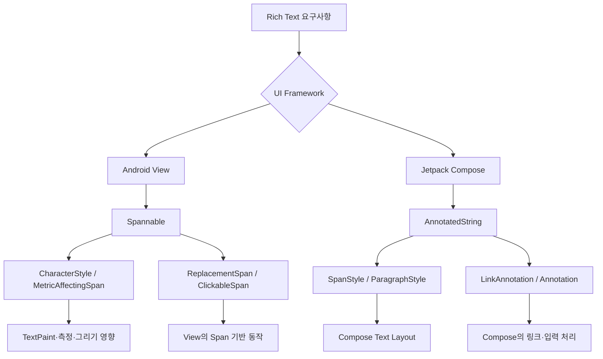
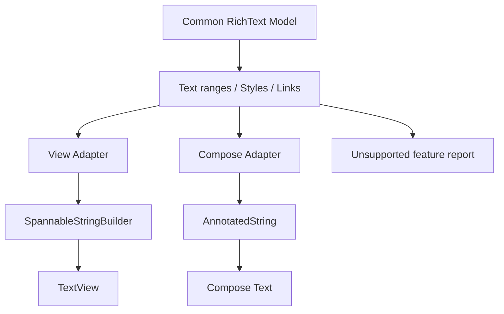

# AnnotatedString vs Spannable

ANDROID TEXT ENGINEERING · 02 · 2026.11.22

부분 텍스트 스타일, 링크, 클릭 이벤트, 커스텀 Span을 비교합니다. Android View의 `Spannable`은 텍스트 범위에 Span 객체를 붙입니다. Compose의 `AnnotatedString`은 범위별 스타일과 어노테이션을 담는 불변 데이터입니다.

이 저장소의 **Rich text** 탭은 영어, 한국어, 아랍어와 이모지가 섞인 하나의 샘플을 두 방식으로 렌더링합니다. 넓은 창에서는 자동으로 왼쪽에 Compose, 오른쪽에 TextView가 표시됩니다. **Side by side**를 선택해 이 배치를 고정할 수 있습니다. 각 패널은 첫 기준선, 줄 수, 텍스트 영역 높이를 px로 표시합니다. [비교 캡처](https://seungwan-woo.github.io/compose-text-lab/#rich-text)

## 1. API 대응표

| 기능 | Android View | Jetpack Compose |
| --- | --- | --- |
| 부분 색상 | `ForegroundColorSpan` | `SpanStyle(color)` |
| 부분 굵기 | `StyleSpan` | `SpanStyle(fontWeight)` |
| 배경색 | `BackgroundColorSpan` | `SpanStyle(background)` |
| 밑줄 | `UnderlineSpan` | `TextDecoration.Underline` |
| URL 링크 | `URLSpan` | `LinkAnnotation.Url` |
| 커스텀 클릭 | `ClickableSpan` | `LinkAnnotation.Clickable` |
| 문단 스타일 | `AlignmentSpan`, `LeadingMarginSpan` 등 | `ParagraphStyle` 범위 |
| 인라인 이미지·배지 | `ImageSpan`, `ReplacementSpan` | `InlineTextContent`, `Placeholder` |
| 범위에 대한 커스텀 측정·그리기 | `ReplacementSpan.getSize()`와 `draw()` | 직접적인 1:1 대응 없음 |
| 변경 가능한 텍스트 | `SpannableStringBuilder`와 Span 경계 플래그 | 상태를 변경해 새 `AnnotatedString` 생성 |

`Spannable`은 Span을 추가하거나 제거할 수 있다는 뜻입니다. 텍스트 자체도 편집해야 한다면 `SpannableStringBuilder`를 사용합니다.

## 2. 구조 비교



`Hello Compose and Android`에서 `Compose`는 `[6, 13)`, `Android`는 `[18, 25)`입니다. 이 값은 UTF-16 문자 범위의 경계입니다. 화면 좌표나 사용자가 인식하는 글자 개수와는 다릅니다. 편집 시 이모지나 결합 문자를 다룰 때는 글자 경계를 별도로 확인해야 합니다.

## 3. Compose 구현: 부분 스타일과 링크

```kotlin
import androidx.compose.foundation.text.BasicText
import androidx.compose.runtime.Composable
import androidx.compose.ui.graphics.Color
import androidx.compose.ui.text.LinkAnnotation
import androidx.compose.ui.text.SpanStyle
import androidx.compose.ui.text.TextLinkStyles
import androidx.compose.ui.text.buildAnnotatedString
import androidx.compose.ui.text.font.FontWeight
import androidx.compose.ui.text.style.TextDecoration
import androidx.compose.ui.text.withLink
import androidx.compose.ui.text.withStyle

@Composable
fun ComposeRichText() {
    val text = buildAnnotatedString {
        append("Hello ")
        withStyle(SpanStyle(color = Color(0xFF1565C0), fontWeight = FontWeight.Bold)) {
            append("Compose")
        }
        append(" and ")
        withLink(LinkAnnotation.Url(
            url = "https://developer.android.com",
            styles = TextLinkStyles(style = SpanStyle(textDecoration = TextDecoration.Underline)),
        )) {
            append("Android")
        }
    }
    BasicText(text)
}
```

Compose가 링크 범위를 처리하므로 앱에서 탭 좌표를 텍스트 오프셋으로 변환할 필요가 없습니다. 이 실험 앱은 `FontFamily(Typeface)`로 Android 글꼴을 공유합니다. 이 방식은 요청한 굵기만으로 글꼴을 다시 고르지 않으므로, 강조 범위에는 실제 굵은 `Typeface`도 명시합니다. [앱 구현](../app/src/main/java/io/github/seungwanwoo/composetextlab/RichTextProbes.kt)

## 4. Android View 구현: SpannableStringBuilder

```kotlin
import android.content.Context
import android.graphics.Color
import android.graphics.Typeface
import android.text.Spannable
import android.text.SpannableStringBuilder
import android.text.method.LinkMovementMethod
import android.text.style.ForegroundColorSpan
import android.text.style.StyleSpan
import android.text.style.URLSpan
import android.widget.TextView

fun createViewRichText(context: Context): TextView {
    val text = SpannableStringBuilder("Hello ")
    val boldStart = text.length
    text.append("Compose")
    text.setSpan(StyleSpan(Typeface.BOLD), boldStart, text.length, Spannable.SPAN_EXCLUSIVE_EXCLUSIVE)
    text.setSpan(ForegroundColorSpan(Color.rgb(21, 101, 192)), boldStart, text.length, Spannable.SPAN_EXCLUSIVE_EXCLUSIVE)
    text.append(" and ")
    val linkStart = text.length
    text.append("Android")
    text.setSpan(URLSpan("https://developer.android.com"), linkStart, text.length, Spannable.SPAN_EXCLUSIVE_EXCLUSIVE)
    return TextView(context).apply {
        this.text = text
        movementMethod = LinkMovementMethod.getInstance()
    }
}
```

이 구성에서는 `LinkMovementMethod`가 링크 탭을 `URLSpan` 또는 `ClickableSpan`으로 전달합니다. 실험 앱의 **Android docs**와 **Details**는 URL 또는 앱 내 클릭 이벤트를 기록합니다. URL 검증은 두 엔진의 이벤트 전달과 목적지 값까지 확인합니다.

## 5. 커스텀 Span 마이그레이션

`ReplacementSpan`은 `getSize()`로 너비를 제공하고 필요하면 `FontMetricsInt`를 수정할 수 있습니다. `draw()`에서는 선택한 범위의 콘텐츠를 Canvas에 직접 그립니다. 일반 스타일은 `SpanStyle`로 표현할 수 있지만, 임의의 `ReplacementSpan`과 `MetricAffectingSpan`의 동작은 `AnnotatedString`에 그대로 옮길 수 없습니다.

인라인 배지처럼 공간과 콘텐츠를 따로 지정할 수 있는 경우 Compose에서는 `Placeholder`로 공간을 예약하고 `InlineTextContent`로 Composable을 넣습니다.

```kotlin
import androidx.compose.foundation.background
import androidx.compose.foundation.layout.Box
import androidx.compose.foundation.layout.size
import androidx.compose.foundation.shape.CircleShape
import androidx.compose.foundation.text.InlineTextContent
import androidx.compose.foundation.text.appendInlineContent
import androidx.compose.material3.Text
import androidx.compose.runtime.Composable
import androidx.compose.ui.Modifier
import androidx.compose.ui.graphics.Color
import androidx.compose.ui.text.Placeholder
import androidx.compose.ui.text.PlaceholderVerticalAlign
import androidx.compose.ui.text.buildAnnotatedString
import androidx.compose.ui.unit.dp
import androidx.compose.ui.unit.em

@Composable
fun InlineBadgeExample() {
    val text = buildAnnotatedString {
        append("새 메시지 ")
        appendInlineContent("badge", "[새 알림]")
        append(" 확인")
    }
    val badge = InlineTextContent(Placeholder(1.em, 1.em, PlaceholderVerticalAlign.TextCenter)) {
        Box(Modifier.size(12.dp).background(Color.Red, CircleShape))
    }
    Text(text = text, inlineContent = mapOf("badge" to badge))
}
```

샘플의 원형 배지는 두 방식으로 재구현했습니다. 배지 외에 기존 Span이 글꼴 메트릭을 조작하거나 글리프를 직접 그린다면 해당 동작을 따로 분류하고, 줄 높이와 접근성 의미도 별도로 확인해야 합니다. [Android ReplacementSpan API](https://developer.android.com/reference/android/text/style/ReplacementSpan)

## 6. OEM 공통 프레임워크에서의 설계



공통 컴포넌트는 `TextSpan(start, end, style)`·`LinkRange(start, end, target)`처럼 중립적인 범위 모델을 두고 렌더러별로 변환할 수 있습니다. 이 앱도 같은 텍스트 조각을 두 변환기에 전달합니다. 커스텀 측정, 렌더링, 접근성 동작은 단순 스타일과 분리해 각 엔진의 지원 여부를 명시하는 편이 좋습니다.

| 검증 영역 | 확인할 내용 |
| --- | --- |
| 시스템 폰트·FlipFont | 시스템 글꼴 변경 후 범위별 Typeface가 다시 생성되는지, 대체 글꼴은 어떻게 적용되는지 |
| 링크와 접근성 | TalkBack 탐색 순서, 링크 안내, 길게 누르기와 클릭 영역 |
| 인라인 배지 | 줄 높이, 기준선, 배지가 줄 경계나 글꼴 크기 변경 시 잘리는지 |
| Rich Text 편집 | 삽입·삭제에 따른 범위 변환과 View Span 경계 플래그 |
| 다국어 | 한국어·영어·아랍어·이모지 혼합과 BiDi, 대체 글꼴 |

## 7. 테스트 앱 검증 결과

Android 17 · API 37.2 에뮬레이터의 fontScale 1.6 미리보기에서, 이 샘플은 양쪽 첫 기준선이 **71px**, 줄 수가 **5줄**, 패딩을 포함한 텍스트 영역 높이가 **413px**였습니다. 이 값은 캡처에서 관찰한 결과입니다. [검증 실행](https://github.com/seungwan-woo/compose-text-lab/actions/runs/44964159694) · [캡처 원본 ZIP](https://github.com/seungwan-woo/compose-text-lab/actions/runs/44964159694/artifacts/14730499841)

| 항목 | 확인한 범위 |
| --- | --- |
| 부분 색상·굵기·밑줄 | 스타일 범위와 Compose의 실제 굵은 Typeface를 검사하고 화면을 캡처했습니다. 렌더링 일치를 픽셀 단위로 검사하지는 않았습니다. |
| URLSpan과 LinkAnnotation 클릭 | 양쪽 URL과 커스텀 링크를 눌러 같은 목적지·이벤트가 전달되는 것을 검증했습니다. |
| TalkBack 탐색·접근성 | 별도 기기 검증이 필요합니다. |
| 인라인 배지의 기준선·줄 높이 | Compose 플레이스홀더와 View `ReplacementSpan`이 적용됨을 검사했습니다. 위 수치는 배지를 포함한 전체 텍스트 영역의 관찰값입니다. |
| 시스템 폰트·fontScale | 미리보기 1.6에서 스타일과 클릭을 확인했습니다. 시스템 폰트와 FlipFont 변경은 미검증입니다. |
| 삽입·삭제 시 Span 범위 | 편집 중 동작은 미검증입니다. |
| 스크린샷·국소 픽셀 비교 | 양쪽 캡처를 저장합니다. 국소 픽셀 차이 또는 허용 오차 비교는 미검증입니다. |

[Android 테스트 소스](../app/src/androidTest/java/io/github/seungwanwoo/composetextlab/RichTextTest.kt)

## 8. 적용 버전 및 Toolchain

2026년 11월 22일 기준입니다.

| 항목 | 이 프로젝트에서 검증한 조합 | Compose 1.13.0 전환 시 고려할 점 |
| --- | --- | --- |
| Compose UI / Foundation | BOM `2025.12.00`, UI/Foundation `1.10.0` | `1.13.0` Stable은 11월 18일 릴리스입니다. BOM `2026.11.01`은 UI와 Foundation을 모두 `1.13.0`으로 매핑합니다. |
| AGP / SDK | AGP `8.13.2`, `compileSdk` / `targetSdk` 36, `minSdk` 26 | `ui-android`와 `foundation-android` 1.13.0의 AAR 메타데이터는 **compile SDK 37.1 이상**, **AGP 9.1.0 이상**을 요구합니다. |
| Kotlin | Kotlin과 Compose compiler 플러그인 `2.2.21` | AGP와 Kotlin 플러그인 조합을 별도 빌드로 검증해야 합니다. |
| `LinkAnnotation` | 현재 조합에서 동작 확인 | Compose 1.7부터 사용할 수 있으며, 새 코드는 `addUrlAnnotation()` 대신 이 API를 사용합니다. |

에뮬레이터를 API 37.2로 올린 변경은 실행 환경에 적용됩니다. Compose 1.13.0 조합의 빌드나 `targetSdk` 37 동작은 검증 범위에 포함하지 않았습니다.

- [Compose 텍스트 선택 및 링크](https://developer.android.com/develop/ui/compose/text/user-interactions)
- [AnnotatedString.Builder API](https://developer.android.com/reference/kotlin/androidx/compose/ui/text/AnnotatedString.Builder)
- [Compose UI 릴리스 노트](https://developer.android.com/jetpack/androidx/releases/compose-ui#1.13.0)
- [Compose BOM 2026.11.01 POM](https://dl.google.com/dl/android/maven2/androidx/compose/compose-bom/2026.11.01/compose-bom-2026.11.01.pom)
- [Compose UI 1.13.0 AAR](https://dl.google.com/dl/android/maven2/androidx/compose/ui/ui-android/1.13.0/ui-android-1.13.0.aar) · [Foundation 1.13.0 AAR](https://dl.google.com/dl/android/maven2/androidx/compose/foundation/foundation-android/1.13.0/foundation-android-1.13.0.aar)

다음 비교 주제는 `EditText`와 Compose `TextField`의 IME 연결, 입력 필터, `TextFieldState`, 선택 범위와 조합 범위입니다.
