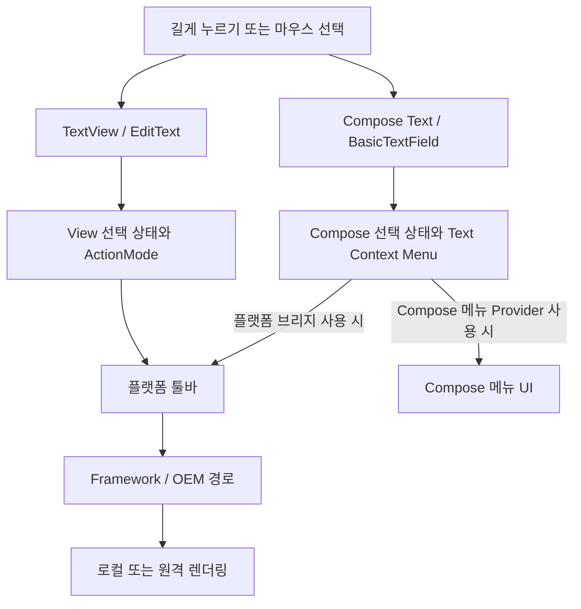

# Text Selection & Floating Toolbar

ANDROID TEXT ENGINEERING · 04 · 2026.11.23

**Compose Text Context Menu vs View ActionMode**

Compose와 View는 기본 선택 메뉴를 제공하지만, 선택 상태를 관리하고 메뉴를 구성하는 API가 다릅니다. 이 앱은 Android 17 · API 37.2에서 화면과 공개 API로 관찰한 결과를 비교합니다. [선택 메뉴 캡처](https://seungwan-woo.github.io/compose-text-lab/#captures)

## API 대응과 구현 범위

| 기능 | Android View | Jetpack Compose | 현재 앱 |
| --- | --- | --- | --- |
| 읽기 전용 선택 | `setTextIsSelectable(true)` | `SelectionContainer` | 둘 다 구현 |
| 편집과 선택 범위 | `EditText.selectionStart` / `selectionEnd` | `BasicTextField`의 `TextFieldValue.selection` 또는 `TextFieldState.selection` | 현재 앱은 `TextFieldValue`를 쓰고 양쪽 편집기의 선택 이벤트를 기록 |
| 클립보드 | `android.content.ClipboardManager` | `LocalClipboard`, `ClipEntry` | 선택 메뉴는 각 엔진에 맡김. 별도 전체 복사 버튼과 선택 복사·붙여넣기 왕복 검증은 없음 |
| 메뉴 항목 확장 | `ActionMode.Callback` | `appendTextContextMenuComponents`, `filterTextContextMenuComponents` | View에서 `Lab: log selection`을 추가하고 콜백을 기록. Compose는 기본 메뉴 사용 |
| 메뉴 Provider | 플랫폼 `ActionMode` | `TextContextMenuProvider` | Compose 커스텀 Provider 없음 |
| 메뉴 앵커 | `ActionMode.Callback2.onGetContentRect()` | Compose 선택 레이아웃과 메뉴 Provider | 두 엔진의 앵커 좌표는 계측하지 않음 |

View의 메뉴 확장은 [SelectionProbes.kt](../app/src/main/java/io/github/seungwanwoo/composetextlab/SelectionProbes.kt)의 `LabActionMode`에서 확인할 수 있습니다. 읽기 전용 Compose `SelectionContainer`의 선택 오프셋은 현재 앱이 로그로 노출하지 않습니다. `Report` 탭의 JSON 복사는 별도 기능이며, 선택 텍스트 복사를 검증하지는 않습니다.

## 처리 경로와 원격 툴바

AOSP의 원격 경로는 선택과 메뉴 요청을 앱 쪽에서 처리하고 툴바 렌더링에는 시스템이 참여하는 구조입니다. 위 그림은 가능한 경로를 설명합니다. 메뉴 모양, 항목, 앱의 `ActionMode` 로그만으로 실제 로컬·원격 경로를 판별할 수 없습니다. One UI에서 이를 확인하려면 OS 빌드에 맞는 Framework 로그나 트레이스가 필요합니다.

## 테스트 범위

| 시나리오 | 확인된 것과 남은 것 |
| --- | --- |
| 터치 길게 누르기 | 양쪽 읽기 전용 프로브에서 `Copy`가 표시되는지 검사하고 툴바와 핸들을 캡처합니다. 핸들 드래그는 별도 검증입니다. |
| 마우스 우클릭·Select all | 양쪽 메뉴에서 `Select all` 노출을 검사합니다. 해당 항목을 눌러 전체가 선택되는지와 메뉴 갱신은 미검증입니다. |
| Copy / Paste | 선택 텍스트의 클립보드 값, MIME type, 붙여넣기 왕복은 미검증입니다. |
| View 커스텀 항목·편집 | 토글과 편집 내용 유지를 확인합니다. 커스텀 항목 클릭은 미검증입니다. |
| Dark Theme / fontScale | 다크 테마와 미리보기 1.6에서 터치 툴바를 캡처합니다. 메뉴 자체의 대비와 fontScale 2.0에서의 앵커는 미검증입니다. |
| 태블릿과 창 크기 | 좁음·중간·넓음에서 배치를 검사하고 넓은 화면을 캡처합니다. 실제 폴더블·멀티윈도우에서 메뉴 앵커와 좌표 변환은 미검증입니다. |
| Translate / Process Text, IME, TalkBack | OEM 메뉴 노출, IME와 툴바 겹침, 접근성 탐색은 별도 테스트가 필요합니다. |

API 26/27에는 `ACTION_PROCESS_TEXT` 메뉴 항목이 누락될 수 있는 플랫폼 문제가 기록되어 있습니다. AndroidX Core `1.15.0`부터 해당 호환 메서드는 deprecated이며, 문서는 `TextView.setCustomSelectionActionModeCallback()`을 직접 사용하도록 안내합니다. 이 변경만으로 구형 OS의 메뉴 구성이 보장되지는 않습니다. [TextViewCompat 문서](https://developer.android.com/reference/androidx/core/widget/TextViewCompat)

## 적용 버전

앱은 Compose UI/Foundation `1.10.0`, AGP `8.13.2`, `minSdk` 26을 사용합니다. `LocalClipboard`는 Compose UI `1.8.0`, `TextContextMenuProvider` 및 메뉴 구성 API는 Foundation `1.9.0`부터 사용할 수 있습니다. [Clipboard API](https://developer.android.com/develop/ui/compose/touch-input/copy-and-paste) · [TextContextMenuProvider](https://developer.android.com/reference/kotlin/androidx/compose/foundation/text/contextmenu/provider/TextContextMenuProvider) · [Text Context Menu Data API](https://developer.android.com/reference/kotlin/androidx/compose/foundation/text/contextmenu/data/package-summary)

2026년 11월 23일 확인 기준 Compose UI/Foundation `1.13.0`과 Material3 `1.5.0`이 안정 버전입니다. Foundation `1.13.0` 계열의 릴리스 노트에는 창이 포커스를 얻기 전에 `BasicTextField`에 포커스를 요청하면 키보드가 표시되지 않던 문제의 수정이 있습니다. 이 앱은 해당 버전으로 전환하지 않았으며, BOM과 최소 빌드 도구 요구사항은 [AnnotatedString vs Spannable](rich-text.md#8-적용-버전-및-toolchain)에 정리했습니다. [Foundation 릴리스 노트](https://developer.android.com/jetpack/androidx/releases/compose-foundation#1.13.0-beta01) · [Material3 릴리스 노트](https://developer.android.com/jetpack/androidx/releases/compose-material3#1.5.0)
